  

&nbsp;

### `montaser@github.com:~$ ls projects/`

<table>
<tr>
<td></td>
<td></td>
</tr>
<tr>
<td></td>
<td></td>
</tr>
</table>

&nbsp;

### `montaser@github.com:~$ ./stats --github`

&nbsp;

### `montaser@github.com:~$ mail montserasad@gmail.com`

