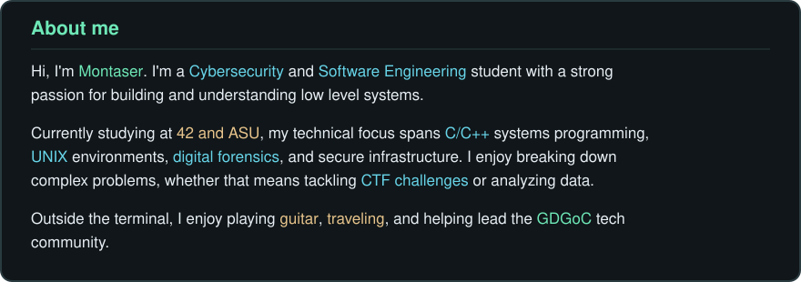
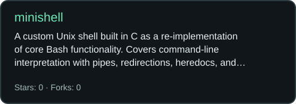
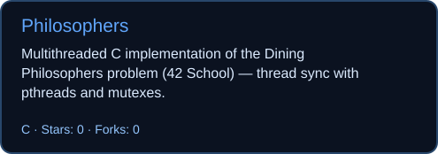
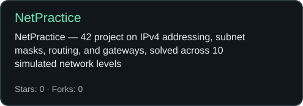
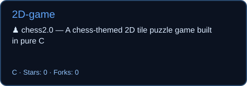
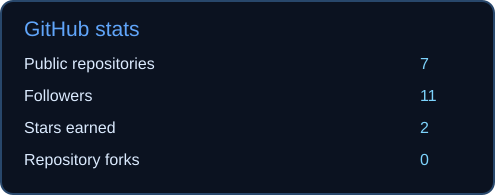

  

&nbsp;

### `montaser@github.com:~$ cat about.txt`

&nbsp;

### `montaser@github.com:~$ ls projects/`

&nbsp;

### `montaser@github.com:~$ ./stats --github`

&nbsp;

### `montaser@github.com:~$ ./contributions`

<picture>
  <source media="(prefers-color-scheme: dark)" srcset="https://raw.githubusercontent.com/Montaser-asad/Montaser-asad/output/github-snake-dark.svg?v=3">
  
</picture>

&nbsp;

### `montaser@github.com:~$ ./contact`

&nbsp;

### `montaser@github.com:~$ logout`
