  

&nbsp;

### `montaser@github.com:~$ ls projects/`

 

&nbsp;

### `montaser@github.com:~$ ./stats --github`

&nbsp;

<pre>
<b>montaser@github.com:~$</b> mail
<a href="mailto:montserasad@gmail.com">montserasad@gmail.com</a>
</pre>
